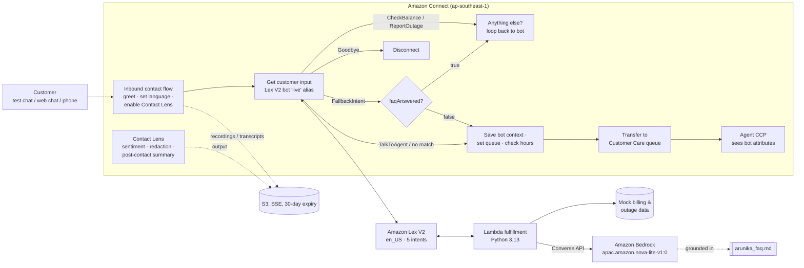

# Amazon Connect AI contact centre (pre-sales demo)

A one-command demo of an AI-assisted contact centre on Amazon Connect, Amazon Lex V2, Amazon Bedrock and Contact Lens, built for a fictional Indonesian telco and deployable into a fresh AWS account in Singapore.

Live demo: <TBD> (runs in your own AWS account; see [Deploy](#deploy))

## Problem and context

Contact centre buyers in Southeast Asia keep asking the same three things in pre-sales:

1. "Can a bot really handle our top call drivers (bill enquiries, outage reports) without a big IVR rebuild?"
2. "Is generative AI safe for customer answers, and what does it cost?"
3. "What happens when the bot can't help? Does the agent see the context?"

This repo answers those questions with a working environment instead of slides. The customer is **Arunika Telecom**, a made-up Indonesian mobile and home-fibre provider. The bot "Ari" handles bill enquiries and outage reports with slot-driven answers from mock back-end data. It answers free-text questions from a small FAQ document through Amazon Bedrock, and hands off to a human agent with context. Contact Lens provides sentiment, PII redaction and post-contact summaries.

Everything is infrastructure as code (CloudFormation). It deploys in about 10 minutes, can be tested through Connect's built-in **test chat** (no phone number needed), and is torn down with one script.

## Architecture



| Component | What it does | Where |
|---|---|---|
| Connect instance | `CONNECT_MANAGED` identity, Contact Lens and flow logs enabled, S3 storage for chat transcripts and recordings | `infra/template.yaml` |
| Hours, queue, routing profile | "Customer Care" queue (Asia/Jakarta time zone), routing profile with 1 voice or 3 concurrent chats | `infra/template.yaml` |
| Lex V2 bot | Intents `CheckBalance`, `ReportOutage`, `TalkToAgent`, `Goodbye`, `FallbackIntent`; custom slot types for area and service; version and `live` alias | `infra/template.yaml` |
| Connect-Lex association | `AWS::Connect::IntegrationAssociation` (`LEX_BOT`), which also updates the alias resource policy | `infra/template.yaml` |
| Fulfillment Lambda | Slot-driven answers, ticket numbers, and a grounded Bedrock FAQ answer with an escalation flag | `lambda/fulfillment/handler.py` |
| Grounding document | The only source the model may answer from | `lambda/fulfillment/knowledge/arunika_faq.md` |
| Contact flow | Flow-language JSON: logging, language, Contact Lens, greeting, Lex, intent branches, attribute hand-off, hours check, queue | `connect/flows/inbound-flow.json` |

## Quickstart (offline, no AWS account needed)

```bash
./scripts/verify.sh
```

This creates `.venv/`, then checks that the flow JSON parses and the Lambda compiles. It renders the template and runs `cfn-lint` on the source and rendered templates, runs `bash -n` on the scripts, and runs 26 pytest tests. The Lambda tests replace Bedrock with a fake client. Other tests check that the flow, the bot and the template agree: every flow branch matches a bot intent, every action is reachable, and the placeholders match the `Fn::Sub` variables.

## Deploy

Prerequisites: AWS CLI v2, Python 3.10+, an AWS account where you can create IAM roles, and Bedrock access to Amazon Nova Lite in `ap-southeast-1`. Serverless Bedrock models are enabled on first use. If your account or organisation restricts this, enable the model in the Bedrock console first.

```bash
cp .env.example .env            # edit AWS_PROFILE, optionally INSTANCE_ALIAS and DEMO_AGENT_PASSWORD
set -a; source .env; set +a
./scripts/deploy.sh             # zips + uploads the Lambda, renders the template, deploys the stack, creates demo.agent
```

Then test it, still without a phone number:

1. AWS console > Amazon Connect > your instance > **Log in for emergency access**. This signs you in as an admin with your IAM identity.
2. In another browser profile, open `https://<alias>.my.connect.aws/ccp-v2`, sign in as `demo.agent` and set the status to **Available**.
3. In the admin site, choose **Test chat** > **Test settings**, pick the flow **Arunika Inbound - AI Assistant** > **Apply**, and chat. Follow [docs/DEMO_SCRIPT.md](docs/DEMO_SCRIPT.md).

Demo accounts: `10012345` (unpaid), `10067890` (overdue), `10024680` (paid). Known outages: Home Fiber in Jakarta Selatan and Mobile in Surabaya.

**Claiming a phone number is optional.** For voice, go to Channels > Phone numbers > Claim a number, then assign the same flow. A Singapore DID costs USD 0.0395 a day plus USD 0.004 a minute inbound. Singapore numbers can need business documents, and Connect does not sell Indonesian DIDs (see the migration section).

Teardown (asks you to type the stack name first, then empties the buckets and deletes everything):

```bash
./scripts/teardown.sh
```

### What a demo session costs

Prices are from the AWS Price List API for ap-southeast-1 (publication 2026-09-11) and the [Connect pricing page](https://aws.amazon.com/connect/pricing/). New Connect instances use the bundled "Connect Customer" pricing, where Lex and Contact Lens used through Connect are billed at USD 0.

| Item | Rate (ap-southeast-1) | 10-minute demo, 4 chats of about 15 messages | Cost |
|---|---|---|---|
| Connect chat (bot and agent messages, both directions) | USD 0.010 per message | about 60 messages | USD 0.60 |
| Lex V2 text requests through Connect | USD 0 (bundled) | about 20 | USD 0 |
| Contact Lens chat analytics | USD 0 (bundled) | 4 chats | USD 0 |
| Bedrock Nova Lite, APAC profile | USD 0.081 per 1M input tokens, USD 0.324 per 1M output | about 10 calls x 1,100 tokens | < USD 0.01 |
| Lambda, S3, CloudWatch Logs | Free tier or cents | | < USD 0.05 |
| Connect instance sitting idle | USD 0 | | USD 0 |
| **Total** | | | **under USD 1 per session** |

The new-account AWS Free Tier credits cover this. Optional voice costs USD 0.038 a minute plus telephony, and a claimed DID costs about USD 1.20 a month until it is released. Run `teardown.sh` when you are done anyway: nothing should be left running unattended.

## Region choice: ap-southeast-1 (Singapore)

Checked against AWS docs on 2026-11-02:

- **Amazon Connect is not offered in Jakarta (ap-southeast-3).** The nearest Connect Regions are Singapore, Sydney and Tokyo ([Connect Region availability](https://docs.aws.amazon.com/connect/latest/adminguide/regions.html)).
- **Contact Lens in Singapore** supports real-time and post-call analytics, post-chat analytics, generative AI post-contact summaries, evaluations and theme detection. Generative AI contact categorization is not available there yet (same page).
- **Lex V2 in Singapore** supports `en_US`. Several locales are not available in ap-southeast-1, and `id_ID` exists only with limited (third-party ASR/TTS) features ([Lex languages](https://docs.aws.amazon.com/lexv2/latest/dg/how-languages.html)). So the bot is `en_US`, and Bahasa Indonesia questions fall through to the Bedrock FAQ answerer, which replies in the customer's language.
- **Bedrock in Singapore:** Amazon Nova Lite is not served in-Region. It is served through the **APAC geo inference profile** `apac.amazon.nova-lite-v1:0`, which routes only to APAC Regions (Tokyo, Seoul, Osaka, Mumbai, Singapore, Sydney) ([Nova Lite model card](https://docs.aws.amazon.com/bedrock/latest/userguide/model-card-amazon-nova-lite.html)).

## Model choice: Amazon Nova Lite through the APAC inference profile

- **Data residency story:** an APAC-only profile is easier to defend to an Indonesian bank or telco risk team (UU PDP and OJK expectations) than a global profile. Newer models such as Nova 2 Lite and Claude Haiku 4.5 are offered from Singapore only through **global** profiles, which can route anywhere.
- **Cost:** USD 0.081 / 0.324 per 1M input/output tokens in ap-southeast-1. A grounded FAQ answer costs about USD 0.0001.
- **Fit:** short, grounded answers from a 1-page document don't need a frontier model. Latency matters more on a voice or chat turn.
- **Swappable:** set `BEDROCK_MODEL_ID` (for example `global.amazon.nova-2-lite-v1:0` or `global.anthropic.claude-haiku-4-5-20251001-v1:0`). The IAM policy is derived from the ID. Anthropic models also need a one-time AWS Marketplace subscription in the account.

## Design decisions and trade-offs

- **Bot conversation closes after each intent.** Connect then branches on the intent name and on session attributes (`faqAnswered`, `ticketId`, `accountStatus`). That keeps the routing logic visible in the flow designer, where contact centre admins expect it, instead of hiding it in Lambda.
- **Generative AI only on the fallback path.** Top call drivers use deterministic, slot-driven answers, and only unmatched questions go to the model. The model must answer from the document or say `NO_ANSWER`, which escalates to a human. A Bedrock error also escalates rather than failing the contact.
- **Flow JSON as a separate file.** `connect/flows/inbound-flow.json` is readable and diffable, and can be imported into the flow designer. `scripts/render_template.py` inlines it into the template at deploy time, so there is one source of truth.
- **Contact Lens set in the flow,** with redaction (entity-type masking), sentiment and post-contact summaries for chat and voice. The instance-level `ContactLens` attribute alone does not analyse anything.
- **Security:** least-privilege IAM (Bedrock limited to one profile and model; logs to one log group). The S3 bucket is encrypted, blocks public access, requires TLS and expires objects after 30 days. Logs show only the last 3 digits of account numbers. No passwords are in the template: the demo agent password comes from an environment variable at deploy time.
- **Cost:** no always-on resources. Everything is pay-per-use, and the Connect instance itself has no fixed fee.
- **Scaling:** Connect, Lex, Lambda and Bedrock are managed and scale per request. The first limits to check for a real rollout are the Lex runtime quotas (never use `TestBotAlias` in production), Bedrock tokens-per-minute quotas, and Connect concurrent contacts.
- **Not production:** mock data, a single locale, no CRM or SSO, no CI pipeline, no Bedrock Guardrails or Knowledge Base. See [Next steps](#next-steps) and [docs/SOW_TEMPLATE.md](docs/SOW_TEMPLATE.md).

## Cisco UCCE / UCCX / WxCC to Amazon Connect: migration considerations

Activeo-style partners sell both stacks, so the honest answer is "it depends on what the customer has invested in". The main areas to cover in discovery:

| Area | Cisco today | Amazon Connect equivalent | Watch-outs |
|---|---|---|---|
| Routing scripts | UCCE ICM scripts, UCCX CRS/Editor scripts, WxCC Flow Designer | Contact flows (flow language JSON), queues, routing profiles, routing criteria and proficiencies | No automatic converter: re-design, don't transliterate. Skill-group logic maps to routing profiles plus proficiencies. Precision queues map reasonably well. |
| IVR / self-service | CVP VXML apps, Nuance speech, UCCX prompts | Lex V2 bots, Polly TTS, Lambda | Re-record or re-synthesise prompts. Check `id_ID` Lex feature limits; Bahasa ASR/TTS quality must be piloted. |
| Telephony | CUCM + CUBE SIP trunks to the local carrier | Connect-provided numbers (DID/TFN/UIFN), number porting where supported | Connect sells no Indonesian DIDs, and Indonesian toll-free was removed from coverage (verify in the [telecoms coverage PDF](https://d1v2gagwb6hfe1.cloudfront.net/Amazon_Connect_Telecoms_Coverage.pdf)). Options: carrier forwarding of 14xxx/0800 numbers to Connect numbers, UIFN, or a partner carrier. Plan latency tests from Jakarta to Singapore. |
| Agent desktop | Finesse gadgets, Webex CC Agent Desktop | CCP / Agent Workspace, step-by-step guides, third-party apps | Rebuild Finesse gadgets as workspace apps. Retrain agents on a new UI. |
| CTI / CRM | Finesse REST, CTI OS, Salesforce/ServiceNow connectors | Streams API, Customer Profiles, native Salesforce/ServiceNow/Zendesk integrations | Inventory every screen-pop and click-to-dial integration. |
| Reporting / WFM / QM | CUIC, Calabrio/Verint (WFO), WxCC Analyzer | Real-time and historical metrics, Contact Lens, evaluations, forecasting and scheduling | Historical data won't migrate: export the CUIC archive. Calabrio/Verint can stay through integrations if a WFM refresh is out of scope. |
| Recording | MediaSense, Calabrio, Verint | Native recording to S3 and Contact Lens | Retention and legal hold rules, and encryption keys (KMS). |
| Commercials | Perpetual licences plus SWSS, or Flex subscriptions per agent | Pay per minute or message, no seats | Model the crossover: per-minute pricing wins for spiky or seasonal volume, and long-handle-time voice can cost more. Count stranded Cisco licence and hardware costs. |
| Coexistence | | Phased cutover by queue or line of business; SIP/PSTN transfer between platforms | Plan a coexistence period with transfers through the PSTN or carrier. Avoid a big-bang cutover for over 200 agents. |

Rule of thumb for the pitch: **UCCX customers at end of support** are the easiest Connect wins. **Large UCCE estates** with heavy CVP investment are often better served by WxCC, or by a phased hybrid that starts with chat and AI self-service on Connect.

## What I'd tell a customer

- Start with the **top 3 call drivers**, deterministic answers and clean escalation. Generative AI is the safety net for the long tail, not the front door.
- **Measure containment and transfer-with-context, not "bot accuracy".** The KPI is fewer repeated questions to agents and shorter handle time, which Contact Lens shows directly.
- **Decide data residency up front:** choose between the APAC and global Bedrock profiles, set the Contact Lens redaction policy and the S3 retention period before the PoC, not after legal review.
- Per-minute pricing makes a **small PoC cheap and reversible**. Run it on one line of business and real traffic for 4-6 weeks before you sign a 3-year plan.

## Repo layout

```
infra/template.yaml               CloudFormation (source; flow injected at deploy)
connect/flows/inbound-flow.json   Contact flow in Connect flow language
lambda/fulfillment/               Lambda handler + grounding FAQ
scripts/deploy.sh | teardown.sh   AWS CLI deploy / delete (profile + region from env)
scripts/render_template.py        Inlines the flow JSON into build/template.yaml
scripts/verify.sh                 Offline checks (cfn-lint, py_compile, pytest)
tests/                            Lambda unit tests (mocked Bedrock) + flow/template consistency tests
docs/DEMO_SCRIPT.md               10-minute pre-sales storyline
docs/SOW_TEMPLATE.md              Sample scope of work, effort and cost estimate
WALKTHROUGH.md                    Plain-language explanation + interview prep
```

## Next steps

- Replace the single FAQ document with a **Bedrock Knowledge Base** and **Bedrock Guardrails** (denied topics, PII filters, contextual grounding check).
- Add an `id_ID` locale after a Bahasa ASR/TTS pilot, and use the Connect language attribute to pick the locale.
- Add an **agent workspace step-by-step guide** and **Amazon Q in Connect** agent assist, and Contact Lens **rules** (for example, alert a supervisor on negative sentiment).
- Add a CI pipeline (cfn-lint, pytest, cfn-guard) and a second stage account.
- Export the flow from the designer after visual edits, and keep the JSON in git.
